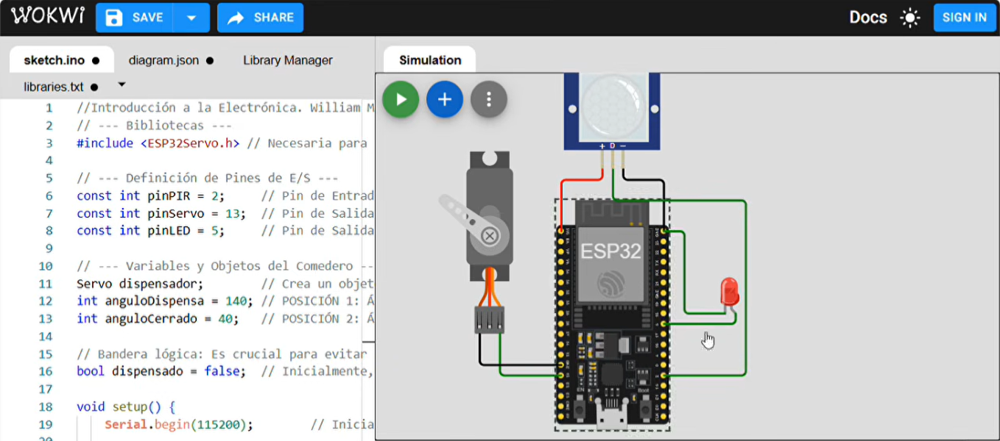
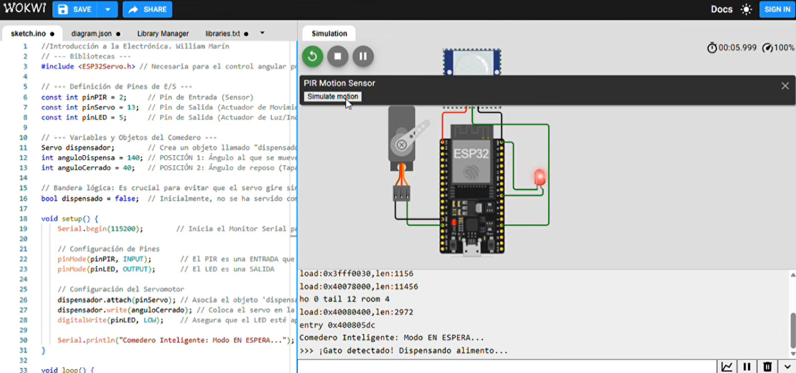

# comedero-inteligente-EL1200
Comedero para gatos desarrollado con ESP32 y simulado con Wokwi. Utiliza un sensor PIR, un servomotor y un LED para detectar la presencia del gato y dispensar automáticamente el alimento.

# Comedero Inteligente para Gatos

Proyecto del curso EL-1200 Introducción a la Electrónica, TEC, II semestre 2026.

**Integrantes:** <Sophia_Vargas_Morales>

## Descripción
Comedero automático que dispensa alimento cuando detecta la presencia de un gato, evitando servir comida repetidamente.

## Funcionamiento
- El sensor PIR detecta la presencia del gato.
- El servomotor abre la compuerta durante 1,5 segundos y luego la cierra.
- El LED indica cuándo se está sirviendo alimento.
- Una variable booleana (dispensado) evita dispensar comida nuevamente mientras el gato permanece frente al comedero.

## Conexiones
| Componente | Pin del ESP32 |
|---|---|
| Sensor PIR | GPIO 2 |
| Servomotor | GPIO 13 |
| LED (con resistencia de 220 Ω) | GPIO 5 |
| Alimentación | 3V3 y GND |

## Simulación
Proyecto realizado en Wokwi: <[enlace público de Wokwi](https://wokwi.com/projects/480414024537845761)>

## Código
El código fuente se encuentra en la carpeta firmware/.

Biblioteca utilizada: ESP32Servo.

## Evidencia

## Mejoras futuras
- Incorporar horarios para programar las comidas.
- Agregar un sensor para medir el nivel de alimento disponible.
